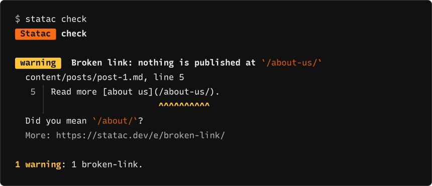
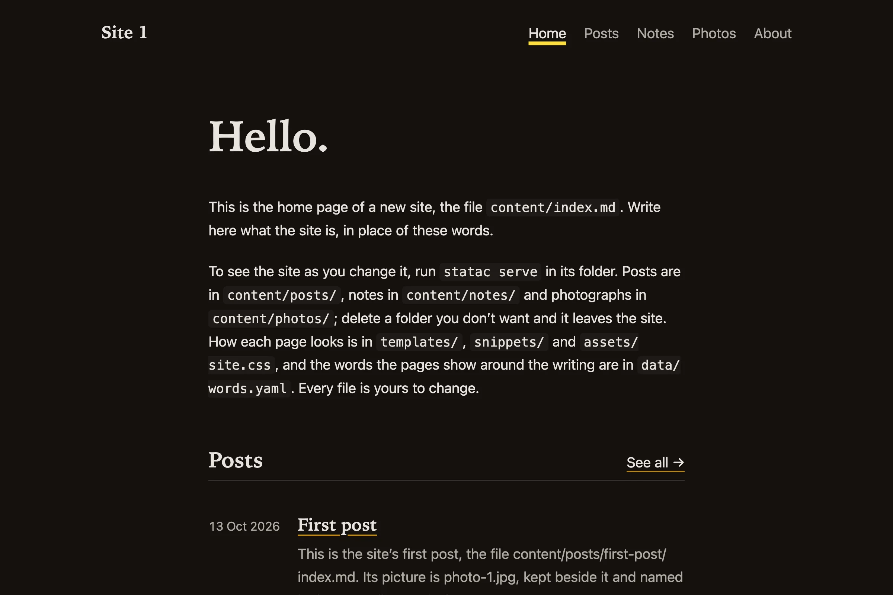

<h1 align="center">
  <picture>
    <source media="(prefers-color-scheme: dark)" srcset=".github/readme/statac-dark.svg">
    <source media="(prefers-color-scheme: light)" srcset=".github/readme/statac-light.svg">
    
  </picture>
</h1>

<p align="center">The friendly static site generator.</p>

<p align="center">
  <a href="https://github.com/statac-ssg/statac/releases/latest"></a>
  <a href="https://github.com/statac-ssg/statac/actions/workflows/release.yml"></a>
  <a href="https://statac.dev/install/"></a>
  <a href="#licence"></a>
</p>

<p align="center"><b><a href="https://statac.dev/getting-started/">Get started</a> · <a href="https://statac.dev/install/">Install</a> · <a href="https://statac.dev">Documentation</a> · <a href="https://statac.dev/e/">Problems explained</a> · <a href="CHANGELOG.md">Changes</a></b></p>

> [!IMPORTANT]
> Statac 0.7.0 is coming, with breaking changes: settings are renamed and
> new sites start plainer. [What's changing](https://statac.dev/whats-changing/)

Statac makes a website from a folder of writing. You write pages in
Markdown, choose how they look with templates, and run `statac build`. It
writes a site of plain files, ready to put on any web host. Statac adds
no JavaScript to a page unless you ask it to: in a new site, only the
search page has any.

It is one program in one file, with no plugins and nothing else to
install beside it.

## When something is wrong, it says where

<p align="center">
  
</p>

Statac explains itself. When something in the site is wrong, it shows you
the file, the line and the exact text, says what it did or why it
stopped, and links to a page about that kind of problem.
`statac explain broken-link` shows the same explanation in the terminal.

## What you get

- **Broken links caught.** Statac checks every
  [link within your site](https://statac.dev/problems/#links) before
  anything is published, including the heading it points to.
- **Photographs handled.** Write an ordinary Markdown
  [picture](https://statac.dev/pictures/). Readers get it in several
  sizes, as AVIF with a JPEG fallback.
- **Search built in.** A new site has a
  [search page](https://statac.dev/search/) that finds pages as the
  reader types, from an index Statac writes at each build, with nothing
  outside your site needed. `statac search` gives the same results in
  the terminal.
- **Sharing cards.** After `statac new --cards`, Statac draws a
  [link preview](https://statac.dev/sharing-cards/) for every page, from
  a layout you set.
- **Yours, kept up to date.** Every template is a file in your site.
  [`statac new --update`](https://statac.dev/new/#update) replaces only
  the ones you haven't changed.
- **Bring your site with you.** `statac import` brings a Hugo, Jekyll,
  Zola or Eleventy site across, and lists anything it couldn't bring.
  See [Arriving from another tool](https://statac.dev/import/).
- **One program.** Sass, coloured code, feeds and a sitemap are built
  in. There are no plugins to hunt down.

And the rest: tags and series, several languages, webmentions, a preview
that reloads as you save, and nothing published unless the whole build
succeeds.

## Installing

On a Mac, with [Homebrew](https://brew.sh):

```sh
brew install statac-ssg/statac/statac
```

On Linux:

```sh
curl -fsSL https://get.statac.dev | sh
```

On Windows, with [Scoop](https://scoop.sh):

```powershell
scoop bucket add statac https://github.com/statac-ssg/scoop-statac
scoop install statac
```

For another way to install, each
[release](https://github.com/statac-ssg/statac/releases) has a package
for each kind of machine. [Installing](https://statac.dev/install/)
says which to take and how to check it.

## A first site

```sh
statac new site-1
cd site-1
statac serve
```

`statac new` asks five questions and writes a site you can change;
`statac serve` builds it, shows it at `http://localhost:3000/` and builds
it again on every save.

<p align="center">
  
</p>

## Documentation

Everything else is at [statac.dev](https://statac.dev).

## Licence

Statac is offered under the MIT licence or the Apache License 2.0, at your
choice. `THIRD-PARTY.md` lists the work of others that it carries, each
with its licence.
